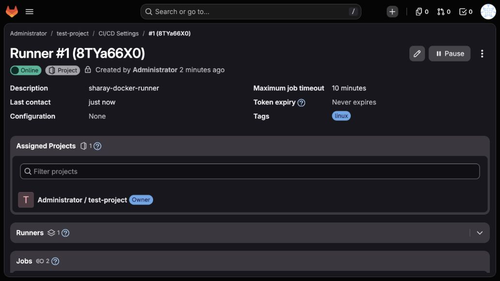
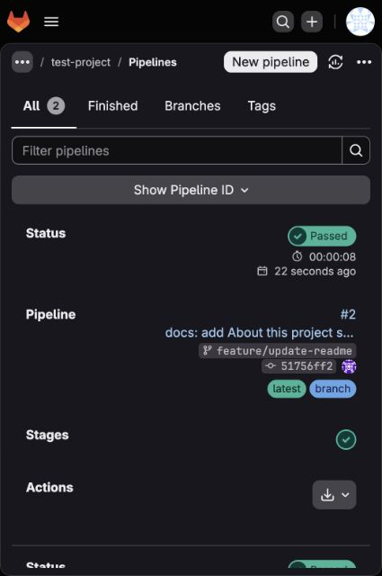
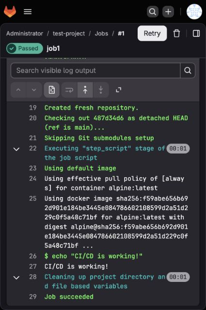
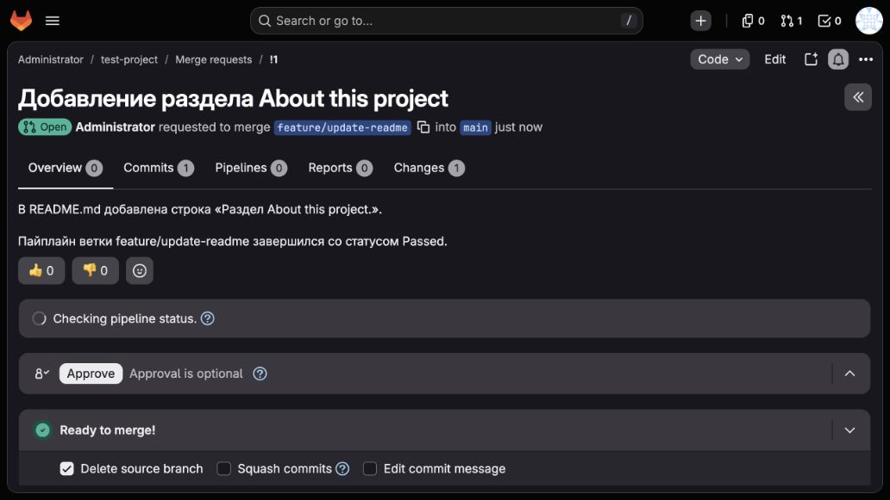
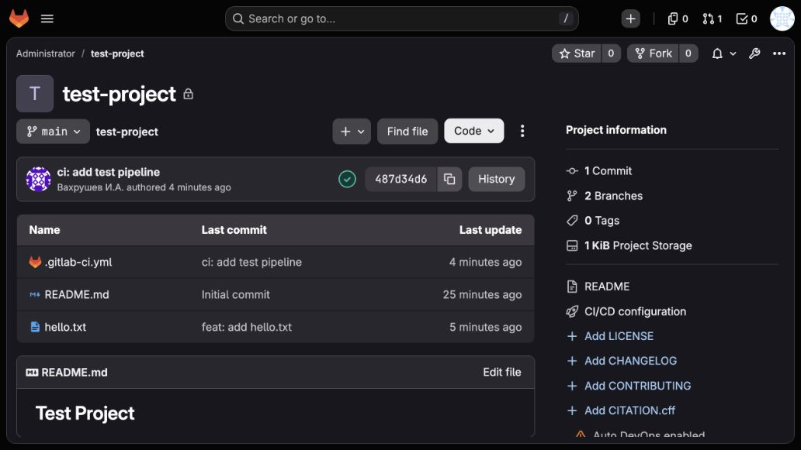

# Практическая работа 2

Развёртывание GitLab и GitLab Runner на виртуальной машине.

**Студент:** Вахрушев И.А.  
**Группа:** 25-КМ-ИБ2  
**Выполнено:** 25 ноября 2026 года.

## Среда

| Компонент | Параметры |
|---|---|
| Компьютер | macOS 26.3, ARM64 |
| Виртуальная машина | Lima 2.3.0, Ubuntu 22.04 ARM64 |
| Ресурсы ВМ | 4 ядра, 8 ГБ памяти, виртуальный диск 32 ГБ |
| GitLab CE | 19.6.1-ce.0 |
| GitLab Runner | 19.6.1 |
| Docker Engine | 29.1.3 |
| Git в Ubuntu | 2.34.1 |

GitLab установлен пакетным способом внутри Ubuntu. Веб-интерфейс доступен на Mac по адресу `http://127.0.0.1:8929`, SSH — на порту `2222`. Адрес относится к локальной установке и не открывается как публичный сайт с другого компьютера.

## Что выполнено

1. Создана Ubuntu-машина, обновлены пакеты, установлены зависимости и Postfix.
2. Установлены GitLab CE, Docker и GitLab Runner. Проверены службы и вход под root; начальный пароль изменён.
3. Создан приватный проект `root/test-project`. В GitLab добавлен отдельный публичный SSH-ключ; код отправлен с Mac по SSH.
4. Добавлен `hello.txt` со строкой `Hello from GitLab!`, коммит `f8d4e56`.
5. Создан Runner `sharay-docker-runner` с тегом `linux`. Он закреплён за проектом, использует Docker executor и образ `alpine:latest`. Лимит задания — 600 секунд.
6. Добавлен `.gitlab-ci.yml`, коммит `487d34d`. Пайплайн № 1 для `main` завершился со статусом **Passed**.
7. Создана и отправлена ветка `feature/update-readme` со строкой «Раздел About this project.», коммит `51756ff`. Пайплайн № 2 этой ветки также **Passed**.
8. Создан Merge Request № 1 из `feature/update-readme` в `main`; запрос оставлен открытым для просмотра.

## CI/CD

```yaml
stages:
  - test

job1:
  stage: test
  tags:
    - linux
  script:
    - echo "CI/CD is working!"
```

Тег `linux` добавлен к примеру методички для выбора зарегистрированного Runner. Задание выполняется в образе, выбранном при регистрации Runner.

Фактический вывод задания № 1:

```text
$ echo "CI/CD is working!"
CI/CD is working!
Job succeeded
```

| Пайплайн | Ветка | Статус | Время |
|---|---|---|---|
| 1 | main | Passed | 22 с |
| 2 | feature/update-readme | Passed | 8 с |

## Файлы

- `test-project/` — файлы основной ветки клиентского проекта.
- `test-project.bundle` — Git-архив с полной историей и ветками этого проекта.
- `evidence/README_feature.txt` — README из отдельной ветки.
- `evidence/` — реальные снимки GitLab, журнал job1, результаты и вывод команд Git.
- `lima-gitlab.yaml` — параметры ВМ.
- `install_gitlab_vm.sh` — сценарий установки, предназначенный для Ubuntu внутри отдельной ВМ.

Для просмотра полной истории можно клонировать Git-архив в новую папку:

```sh
git clone test-project.bundle restored-test-project
cd restored-test-project
git log --oneline --graph --all
```

## Изменения по отношению к методичке

Для Mac ARM выбрана Ubuntu ARM64 под Lima. Вместо стандартных портов использованы локальные порты 8929 и 2222. При первой настройке порт 8082 оказался занят метриками Puma, поэтому веб-интерфейс перенесён на 8929. Для Runner указан адрес ВМ `192.168.5.15:8929`, доступный контейнерам. В CI-конфигурацию добавлен тег `linux`.

Установочные сценарии и сохранение вывода подготовлены для автоматизации последовательности действий. Команды echo, содержимое hello.txt, основные задания и проверяемый результат взяты из методички.

## Снимки выполнения

### Подключённый Runner



### Успешный пайплайн



### Вывод задания



### Merge Request



### Файлы проекта



## Документация

- [Установка GitLab на Ubuntu](https://docs.gitlab.com/install/package/ubuntu/)
- [Регистрация Runner](https://docs.gitlab.com/runner/register/)
- [Docker executor](https://docs.gitlab.com/runner/executors/docker/)
