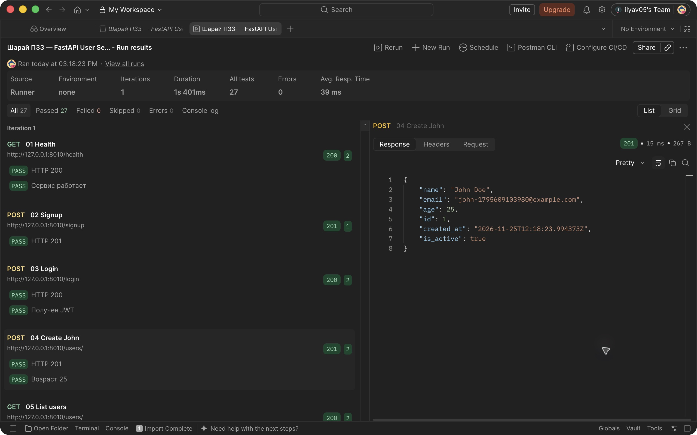
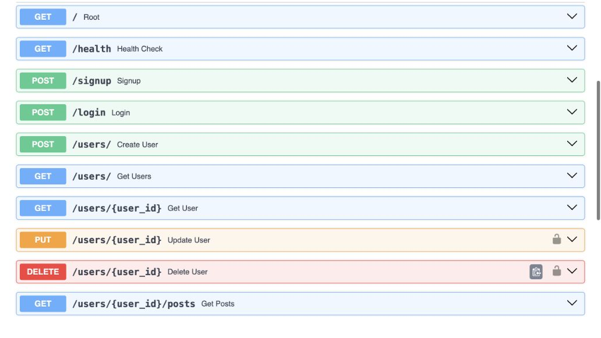

# Практическая работа 3

FastAPI, Postman, интеграции. Вахрушев И.А., группа 25-КМ-ИБ2. Выполнено 25 ноября 2026 года.

Разработан User Service с CRUD, фильтром по возрасту, регистрацией и входом с JWT. Изменение и удаление защищены Bearer-токеном. При создании пользователя вызывается отдельный Notification Service; публикации запрашиваются у JSONPlaceholder.

## Запуск

Нужен Python 3.10 или новее. Проверено на macOS ARM64, Python 3.12.14.

```bash
python3 -m venv .venv
source .venv/bin/activate
python -m pip install -r requirements.txt
python run_services.py
```

На учебном Mac окружение уже установлено в папке `Практическая 3`. Там также есть файл `Запустить сервисы.command` для запуска двойным щелчком.

- Документация: <http://127.0.0.1:8010/docs>.
- Проверка сервиса: <http://127.0.0.1:8010/health>.
- Полученные уведомления: <http://127.0.0.1:8011/notifications/>.
- Остановка обоих процессов: Ctrl+C в окне запуска.

Порты 8000 и 8001 из методички были заняты компонентами Adobe, поэтому использованы 8010 и 8011. GitLab из второй работы для этой практической запускать не требуется.

Данные и учётные записи находятся в памяти процесса, как допускает методичка. После перезапуска нужно заново зарегистрироваться и получить токен. Ключ подписи создаётся при старте, токен действует 30 минут. Notification Service имитирует отправку и пишет сообщение в журнал; настоящую почту не отправляет.

## Проверка в Postman

Импортировать `User_Service.postman_collection.json`, выбрать коллекцию → Run → Local → 1 iteration → Start run. Выполнять всю коллекцию по порядку: последующие запросы используют JWT и идентификатор из предыдущих ответов.

Пароль создаётся в локальных переменных запуска, токен также остаётся переменной запуска. В JSON коллекции пароля и токена нет. При запуске можно отключить Keep variable values.

Фактический результат в Postman Desktop 12.38.3: **15 запросов, 27 Passed, 0 Failed, 0 Errors**. Время — 1,401 секунды. Сводка сохранена в `evidence/postman_results.json`, снимки интерфейса — в `evidence/screenshots/`.

| Проверка | Код |
|---|---|
| Регистрация и создание пользователя | 201 |
| Вход, чтение, фильтр и публикации | 200 |
| PUT и DELETE без токена | 401 |
| PUT и DELETE с действующим JWT | 200 |
| Повторное удаление | 404 |
| Неверные email и возраст | 422 |
| Получение уведомления | 200 |

## Автоматические проверки

```bash
python -m pip install -r requirements-dev.txt
python -m pytest -q
```

Фактический результат — **12 passed**. Проверены CRUD, повторное удаление, отсутствующий, повреждённый и истёкший токен, граница min_age, пагинация, валидация и уникальность email при PUT.

Отказы зависимостей воспроизводятся через HTTPX MockTransport: недоступность Notification Service и его ответ 500; ответ внешнего API 503, тайм-аут и некорректный JSON. При сбое уведомлений пользователь остаётся сохранённым. Ошибки внешнего API преобразуются в 502 или 504. Живой запрос через User Service для пользователя 2 вернул десять публикаций с userId = 2; результат — `evidence/live_checks.json`.

В установленной версии Starlette тестовый клиент выдаёт предупреждение об устаревании использования HTTPX. Это предупреждение не препятствовало выполнению проверок; полный вывод сохранён в `evidence/pytest.txt`.

## Файлы и задания

| Файл | Назначение |
|---|---|
| `main.py` | CRUD, Pydantic, JWT, фильтр, HTTP-интеграции |
| `notify_service.py` | Отдельный сервис уведомлений |
| `run_services.py` | Запуск и остановка двух процессов Uvicorn |
| `User_Service.postman_collection.json` | 15 запросов с 27 проверками |
| `test_api.py` | 12 автоматических проверок |
| `requirements-lock.txt` | Версии пакетов проверенного окружения |
| `evidence/` | Результаты, OpenAPI, журналы и настоящие снимки |

Основу CRUD, модели UserBase/UserCreate/User, хранение в памяти, пример John Doe и вызов Notification Service взял из методички. Для самостоятельных заданий дописал min_age, /signup, /login, JWT и внешний API публикаций. Также добавил проверку совпадения email при обновлении, ограничения входных данных и обработку HTTPStatusError для уведомлений; устаревший `.dict()` заменил на `.model_dump()`.

Коллекция Postman, тесты и сценарий одновременного запуска подготовлены при выполнении работы. Это дополнительные файлы для запуска и проверки, а не готовые файлы из методички. В `.vscode/settings.json` указан интерпретатор локального окружения.

## Документация

- [FastAPI — JWT и хеширование паролей](https://fastapi.tiangolo.com/tutorial/security/oauth2-jwt/).
- [Postman — установка приложения](https://learning.postman.com/v11/docs/getting-started/installation/install-app).
- [JSONPlaceholder](https://jsonplaceholder.typicode.com/).




