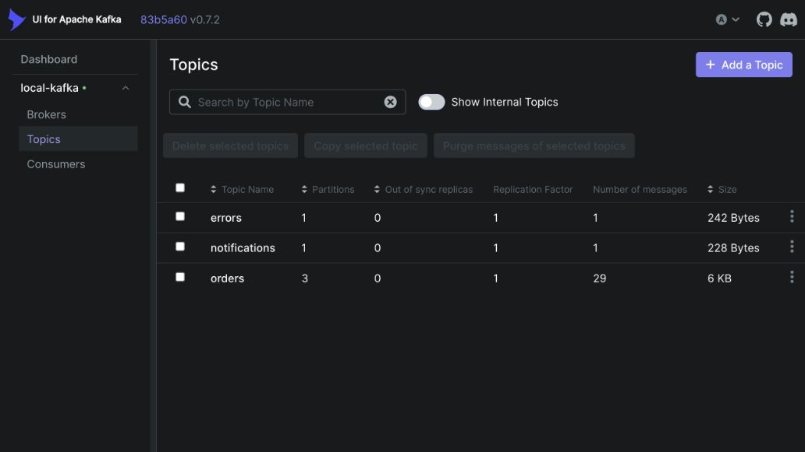
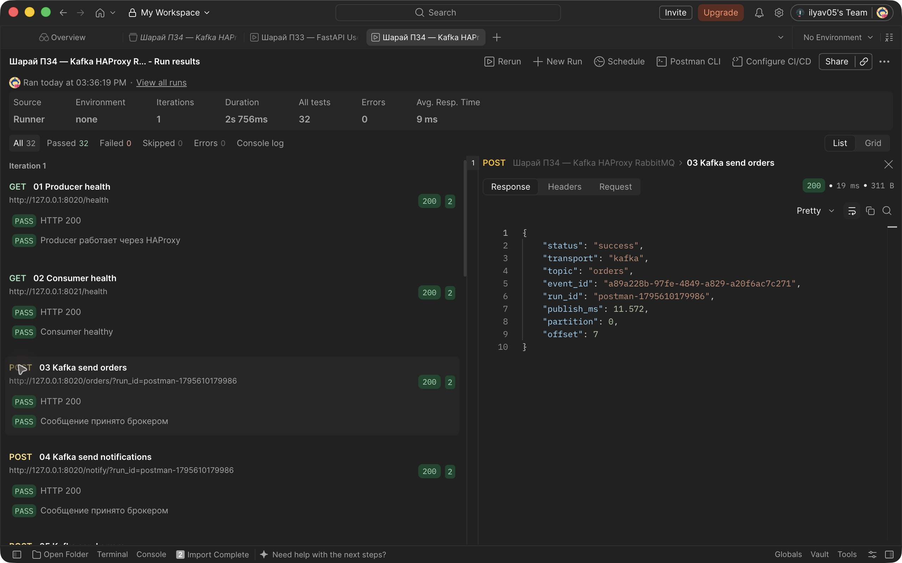

# Практическая работа 4

Apache Kafka, HAProxy, RabbitMQ. Вахрушев И.А., группа 25-КМ-ИБ2. Выполнено 25 ноября 2026 года.

Развёрнуты Kafka и Kafka UI, HAProxy, RabbitMQ и два FastAPI-приложения. Producer принимает HTTP-запросы, Consumer получает и обрабатывает заказы, уведомления и ошибки. Выполнены основная часть и все три самостоятельных задания.

## Запуск на учебном Mac

В папке `Практическая 4` уже есть настроенная среда:

1. Двойной щелчок по `Запустить ПЗ4.command` запускает ВМ `sharay-messaging` и контейнеры.
2. В Postman открыть коллекцию «Шарай ПЗ4 — Kafka HAProxy RabbitMQ» → Run → Local → Start run.
3. Двойной щелчок по `Остановить ПЗ4.command` освобождает 4 ГБ памяти, сохраняя данные брокеров.

После изменения исходников в VS Code запустить `Обновить ПЗ4.command`: он копирует код в ВМ и пересобирает приложения. Код исполняется внутри Docker. GitLab из второй работы запускать не требуется.

| Интерфейс | Адрес на Mac |
|---|---|
| Kafka UI | <http://127.0.0.1:8088> |
| Producer Swagger | <http://127.0.0.1:8020/docs> |
| Consumer Swagger | <http://127.0.0.1:8021/docs> |
| RabbitMQ Management | <http://127.0.0.1:15672> |

Для RabbitMQ создан локальный пользователь `lab`; пароль находится в `.env` на учебном компьютере. Этот файл исключён из Git. Установка доступна на локальном компьютере, а не как публичный сервер.

## Запуск проекта на другом компьютере

Нужны Docker Engine/Desktop и Docker Compose. В папке проекта:

```bash
python3 -c 'import secrets; print("RABBITMQ_PASSWORD=" + secrets.token_hex(24))' > .env
docker compose up -d --build
docker compose ps -a
```

Контейнеры используют именованные тома для Kafka и RabbitMQ. При перезапуске Consumer его HTTP-списки в памяти очищаются, а данные брокеров и offsets остаются. Для новой проверки повторно запустить коллекцию Postman, публикующую новые сообщения.

## Топики и маршруты

| Kafka-топик / очередь RabbitMQ | Партиции Kafka | Producer Kafka | Producer RabbitMQ |
|---|---:|---|---|
| orders | 3 | POST /orders/ | POST /rabbit/orders/ |
| notifications | 1 | POST /notify/ | POST /rabbit/notify/ |
| errors | 1 | POST /errors/ | POST /rabbit/errors/ |

Коэффициент репликации Kafka — 1. Consumer возвращает результаты через GET `/orders/`, `/notifications/`, `/errors/` и соответствующие маршруты `/rabbit/`. `/events/?run_id=...` показывает события конкретной серии вместе со временем доставки и обработки.

Для каждого сообщения создаётся задача `asyncio.create_task`, обработка имитируется задержкой `asyncio.sleep(1)`. Kafka offset фиксируется после завершения порции, RabbitMQ ack — после обработки. Producer Kafka использует идемпотентность и `acks=all`; для RabbitMQ включены publisher confirms, durable-очереди и persistent-сообщения.

## HAProxy и адреса Kafka

Producer и Consumer подключаются к `haproxy:9093`. HAProxy направляет TCP-соединения на `kafka:9094`. Kafka объявляет клиентский адрес `CLIENT://haproxy:9093`, поэтому последующие обращения клиента также проходят через HAProxy. Для Kafka UI предусмотрен внутренний адрес `kafka:9092`.

Выбран `roundrobin`. При одном backend все соединения направляются единственному брокеру. Конфигурация проверена через `haproxy -c`; соединения с `kafka_backend/kafka1` сохранены в журнале.

## Полученные результаты

- **Postman: 16 запросов, 32 Passed, 0 Failed, 0 Errors**, 2,756 секунды.
- Все шесть сообщений функциональной серии — три через Kafka и три через RabbitMQ — получены с исходными полями.
- Пять сообщений Kafka с обработкой по одной секунде завершились за **2,018 секунды**. По временным интервалам максимум одновременно обрабатывались **четыре** сообщения этой серии.
- При временной приостановке контейнера Kafka Producer вернул **503 за 5,017 секунды**. Контейнер возобновлён в `finally`, затем оба приложения снова проверены как healthy.

Ответ 503 означает, что публикация не была подтверждена в установленный срок. После восстановления брокера сообщение ещё может быть доставлено; тест не трактует тайм-аут как доказательство отсутствия сообщения в Kafka.

Измерение доставки: одна ВМ, три прогревочные пары, затем 20 пар; одинаковые заказы, чередование порядка брокеров, ожидание обработки каждой пары. Используется общий монотонный таймер ядра ВМ. Одна секунда искусственной обработки исключена из задержки доставки.

| Брокер | Среднее, мс | Медиана, мс | P95, мс |
|---|---:|---:|---:|
| Kafka через HAProxy | 4,869 | 3,679 | 11,254 |
| RabbitMQ | 2,030 | 1,874 | 2,813 |

В этой серии RabbitMQ доставлял сообщения быстрее. Это сравнение указанных одноброкерных конфигураций; исходные 40 наблюдений находятся в `evidence/benchmark.json`.

Для повторения функциональной проверки и измерений нужен HTTPX:

```bash
python3 -m venv .venv
source .venv/bin/activate
python -m pip install -r requirements-checks.txt
python verify_and_benchmark.py
```

## Среда и отличия от примера

Ubuntu 22.04 ARM64 в Lima 2.3.0, 4 ядра, 4 ГБ памяти, диск 20 ГБ. Docker Engine 29.10.1, Compose 5.8.0. Образы: Kafka 3.9.1, Kafka UI 0.7.2, HAProxy 3.0.12, RabbitMQ 4.1.0, Python 3.12.10. Версии Python-библиотек и идентификаторы образов сохранены в `evidence/`.

Из методички взяты структура двух FastAPI-сервисов, модели заказа и уведомления, исходные данные Laptop, топики, Kafka UI и HAProxy. По самостоятельным заданиям добавлены errors, отдельные задачи обработки, RabbitMQ и сравнение.

Для исполнения в Docker исправлены адреса `localhost` между контейнерами и `advertised.listeners`. Вместо примера с ZooKeeper использован режим KRaft. Версии образов зафиксированы; создана инициализация прав тома Kafka. `.dict()` заменён на `.model_dump()`, добавлены валидация, тайм-аут и поля измерения в заголовках сообщений. Коллекция Postman, сценарий измерения и файлы запуска подготовлены при выполнении работы.

## Материалы

- `producer_service/main.py`, `consumer_service/main.py` — приложения.
- `docker-compose.yml`, `Dockerfile`, `haproxy.cfg` — развёртывание.
- `Messaging.postman_collection.json` — 16 запросов с проверками.
- `evidence/` — фактические результаты, журналы и снимки интерфейсов.

Официальные источники: [Kafka Docker](https://kafka.apache.org/39/getting-started/docker/), [гарантии доставки Kafka](https://kafka.apache.org/39/design/design/), [aiokafka Consumer](https://aiokafka.readthedocs.io/en/stable/consumer.html), [RabbitMQ](https://www.rabbitmq.com/tutorials/tutorial-one-python), [HAProxy](https://www.haproxy.com/documentation/haproxy-configuration-tutorials/proxying-essentials/configuration-basics/backends/).




